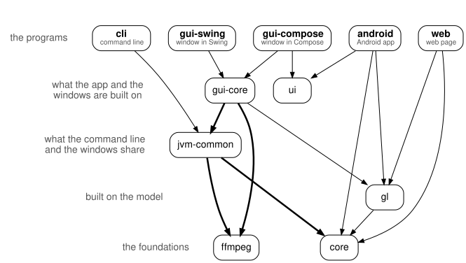
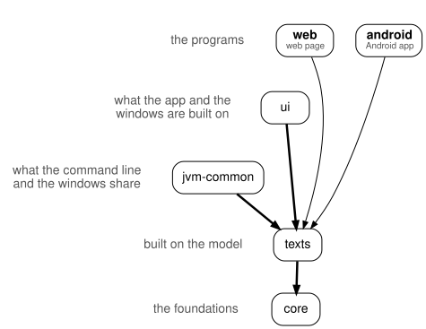
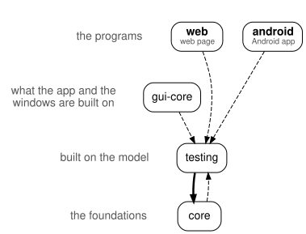
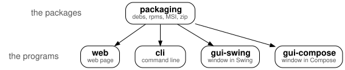

# Developing dog-vision

How the code is laid out, and how a change is checked.\
[Building it](building.md) says how to build the programs.

- [How the code is laid out](#how-the-code-is-laid-out) — the modules, their layers and which uses which, and the GPU renderer they share.
- [Checking it](#checking-it) — what each Gradle task tests, the documents checked against `core`,
  the Kotlin style, the prose's layout, detekt, the tests' coverage, and what GitHub Actions runs.
- The caveats: [the emulator's colours](#caveat-the-emulator-fails-the-video-tests-colour-checks),
  [the Android 17 emulator's decoder](#caveat-the-android-17-emulator-image-keeps-its-decoder-from-the-apps-videos),
  and [Windows without a GPU and under Wine](#caveat-windows-is-tested-without-a-gpu-and-under-wine).
- [Where the test data comes from](#where-the-test-data-comes-from) — the test videos and the reference values.

## How the code is laid out

| Module                            | Holds                                      | Built for           |
|-----------------------------------|--------------------------------------------|---------------------|
| [`core`](../core)                 | the species, the model, the image pipeline | the JVM, JavaScript |
| [`gl`](../gl)                     | the GLSL ES 3.00 passes that render a view | the JVM, JavaScript |
| [`texts`](../texts)               | the wording, in English and Czech          | the JVM, JavaScript |
| [`ui`](../ui)                     | the controls, in Compose Multiplatform     | Android, the JVM    |
| [`android`](../android)           | the Android app                            | Android             |
| [`web`](../web)                   | the web page                               | JavaScript          |
| [`cli`](../cli)                   | the command line                           | the JVM             |
| [`jvm-common`](../jvm-common)     | what the command line and windows share    | the JVM             |
| [`gui-core`](../gui-core)         | what the desktop windows share             | the JVM             |
| [`ffmpeg`](../ffmpeg)             | ffmpeg and ffprobe, found and run          | the JVM             |
| [`gui-compose`](../gui-compose)   | the desktop window, in Compose             | the JVM             |
| [`gui-swing`](../gui-swing)       | the desktop window, in Swing               | the JVM             |
| [`packaging`](../packaging)       | the debs, the rpms, the MSI and the zip    | Linux, Windows      |
| [`testing`](../testing)           | what the renderers' tests compare against  | the JVM, JavaScript |

[`build-logic`](../build-logic) is not a module but a separate Gradle build, included in this one.\
It contains:

- the tasks that make the packages, which a module gets by applying the plugin `cz.loplex.dogvision.packaging`;
- [`windowPackages`](../build-logic/src/main/kotlin/cz/loplex/dogvision/packaging/linux/WindowPackages.kt), which registers those tasks for a window's deb and rpm; both windows use this one function;
- [`glNatives` and `windowsRuntime`](../build-logic/src/main/kotlin/cz/loplex/dogvision/packaging/jvm/DesktopNatives.kt), the natives that `gui-core`'s tests and the windows run with;
- [`artifact()`](../build-logic/src/main/kotlin/cz/loplex/dogvision/packaging/Artifact.kt), which marks a task that makes an artifact, for `./gradlew packageAll` to run;
- `cz.loplex.dogvision.ktlint` and `cz.loplex.dogvision.detekt`,
  which apply ktlint and detekt, at the versions in the catalog, to each module that lists them;
- `cz.loplex.dogvision.nodejs`, which makes the root project and each Kotlin/JS module download Node.js
  from the repository declared in `settings.gradle.kts`;
- [the layout check](../build-logic/src/main/kotlin/cz/loplex/dogvision/layout/Layout.kt), which the root's `checkLayout` runs over the prose.

The root project declares the plugin, so these are on every module's build script classpath.

- **`core` depends on no platform**:
  parts such as the species, the model, the facts and the image pipeline,
  with no video and no window session.\
  The only part written for each platform is how a fact's number is rounded,
  in [`Facts.jvm.kt`](../core/src/jvmMain/kotlin/cz/loplex/dogvision/core/Facts.jvm.kt) and [`Facts.js.kt`](../core/src/jsMain/kotlin/cz/loplex/dogvision/core/Facts.js.kt), since JavaScript has no `BigDecimal`.
- **`gl`'s passes run on every GPU the programs draw on**:
  OpenGL ES 3.0 on Android, WebGL 2 in the browser, and EGL, ANGLE or WGL on the desktop.\
  [`ViewPasses`](../gl/src/commonMain/kotlin/cz/loplex/dogvision/gl/ViewPasses.kt) runs them through [`Gl`](../gl/src/commonMain/kotlin/cz/loplex/dogvision/gl/Gl.kt), the subset of OpenGL ES 3.0 they need, which each program implements.
- **`texts`' strings are in [`texts/strings`](../texts/strings)**, in Android's `strings.xml` format,
  which the build compiles into Kotlin, each string named by an entry of the enum `Str` or `Plural`.\
  The app, the web page, the windows and the command line all take their wording from it.
- **`ui`'s Compose Multiplatform 1.12 is Jetpack Compose 1.12**, and its Material 3 1.9 is androidx Material 3 1.4:
  the versions in the app's Compose BOM, so that the app runs only one version of each.
- **`ui`'s controls have previews** in [`Previews.kt`](../ui/src/commonMain/kotlin/cz/loplex/dogvision/ui/Previews.kt), in English in light colours and in Czech in dark ones,
  which the IDE renders through the Android target, with the Kotlin Multiplatform plugin.
- **The command line and the windows each have options of their own, and share the view's options**:
  [`jvm-common`'s `ViewOptions`](../jvm-common/src/jvmMain/kotlin/cz/loplex/dogvision/common/Options.kt) reads the view's options for both,
  and [`gui-core`'s `runWindow`](../gui-core/src/jvmMain/kotlin/cz/loplex/dogvision/desktop/WindowArguments.kt) handles a window's `--help` and a command line it cannot read,
  and otherwise opens the window.
- **`gui-core` uses neither Compose nor skiko**: Java's own AWT and Swing are its only toolkits.\
  It contains the GL contexts, the renderer of the passes and the ffmpeg feeds,
  and hands the pixels it reads back to a function that turns them into the window's image.\
  Its `LiveSession` holds what a window shows, so that the Compose window and the Swing one only lay it out.
- **The `ffmpeg` module finds and starts ffmpeg and ffprobe**:
  on the `PATH`, even if they were installed after a window started, or on Windows where a window downloaded them.\
  Through them it probes a video, reads its frames, and writes the .mp4 of a conversion or of a window's recording.

### Which module uses which

The modules sit in six layers, each a row of the graphs, named on its left,
and a module's code uses only modules in the layers below its own:

1. the foundations: `core`, the model, and `ffmpeg`, which uses no other module;
2. what is built on the model: `gl`, `texts` and, for tests, `testing`;
3. what the command line and the windows share: `jvm-common`;
4. what the app and the windows are built on: `ui` and `gui-core`;
5. the programs;
6. the packages: `packaging`, which takes the programs.

A module may skip a layer, as `android` uses `core` directly.

An arrow points from a module to one it uses:

- **a thick arrow is `api`**: whatever uses the module gets the one it points at too;
- **a thin arrow is `implementation`**: the module keeps the one it points at to itself;
- **a dashed arrow is for tests only**: the module's tests use it, and its code does not.

A module in bold is a program: its build makes something to run,
the app's APK, the web page, or the packages of the command line and the windows.\
Under its name, in small letters, is what it is, as in the table in [How the code is laid out](#how-the-code-is-laid-out).

What each module uses, leaving out `texts` and the tests:

What uses `texts`:

What uses `testing`, only in tests:

What the packages take; `packaging` builds them from the windows, the command line and the web page:

- **`texts` has a graph of its own, because with it, the first graph has arrows that cross**,
  however the modules are placed:
  `android`, `web`, and `jvm-common` with `gui-core`, are three that each reach the same three,
  `core`, `gl` and `texts`, and no drawing on a plane joins three to three without a crossing.\
  Without `texts`, the first graph has two crossings, the fewest it can have with each layer in a row of its own.
- **`jvm-common` holds what the command line and the windows share**:
  reading the view's options, which each of them takes from its own arguments,
  reading a photo the way it is meant to be seen, and converting a photo or a video at full size.
- **`gui-compose`, `gui-swing` and `cli` reach `core` and `texts` through what they share**:
  the windows through `gui-core`, which passes on `jvm-common`, and `cli` through `jvm-common`, which passes on both.
- **`ui` passes on `texts`**, because its `text` and `InfoButton` take an entry of `texts`' `Str`.
- **`packaging` has no code of its own**: it takes what goes into the packages from the modules that have it:
  - the JARs a Linux package installs, through `jvmRuntimeOf`, the way a module takes a library's;
  - each launcher of a Windows package, its JAR and what it runs on, through the module's `windowsLauncher` task;
  - the web page, through the variant that `webPage` registers in `web`.
- **Only tests use `testing`**, so no program ships it.\
  `core`'s tests use `testing`, which in turn uses `core`;
  Gradle builds `core`'s own code first, since that code does not use `testing`.
- **Graphviz draws each graph from its `.dot` source in [`docs/modules`](modules)**:
  `./gradlew drawModuleGraphs` runs Graphviz's `dot` on each to make the SVG shown here,
  and writes the `.dot`'s SHA-256 into the SVG.
- **`./gradlew checkModuleGraph`, which `check` runs, compares the four graphs with the modules' build files**:
  every dependency declared is drawn in one of them, and nothing is drawn that is not declared.\
  It also checks the layers: every arrow except a dashed one points into a row below its own.\
  It checks each SVG against its `.dot` through the SHA-256, and fails when the `.dot` has changed since,
  so it needs no Graphviz.

### The view is rendered on the GPU, and a photo at full size on the CPU

- **The view is drawn by `gl`'s shaders**, which apply `core`'s matrix and blur,
  and decode and encode sRGB through `core`'s own lookup tables, so that they agree with `core` up to float rounding.
- **In the app, the same passes draw every view**:
  the screen; a recording, which the renderer also draws into an encoder's surface;
  and a video converted at full size, through the Media3 effect [`ViewEffect`](../android/src/main/kotlin/cz/loplex/dogvision/video/ViewEffect.kt).
- **The desktop windows render in a GL context without a window of its own**,
  and read the view back without waiting for the GPU.
- **A photo saved at full size goes through `core`'s CPU pipeline**,
  a strip of rows at a time, on the CPU, where no limit on a texture's size applies.

## Checking it

`./gradlew check` runs every test task below that needs no phone, Android Lint, the Kotlin style,
[the prose's layout](#the-prose-is-laid-out-one-information-to-a-line), [detekt](#detekt-looks-for-likely-bugs-and-code-smells),
and the checks of [the modules' graphs](#which-module-uses-which) and [the artifacts' folders](building.md#every-artifact-at-once).\
Each test class's comment says what it tests.

| Task                                           | Tests                                                |
|------------------------------------------------|------------------------------------------------------|
| `./gradlew :core:jvmTest`                      | the model, against the reference values              |
| `./gradlew :core:allTests`                     | the same, and the JVM and Node.js agreeing           |
| `./gradlew :texts:allTests`                    | every language's strings, plurals, system languages  |
| `./gradlew :ui:jvmTest`                        | the shared controls, in Compose's test scene         |
| `./gradlew :jvm-common:jvmTest`                | EXIF, photos read, converted files, progress, cancel |
| `./gradlew :cli:jvmTest`                       | the options, photo and video, the figures            |
| `./gradlew :gui-core:jvmTest`                  | the window's passes, GL contexts, ffmpeg, session    |
| `./gradlew :ffmpeg:jvmTest`                    | finding ffmpeg, its download, video read and written |
| `./gradlew :gui-swing:jvmTest`                 | image, theme, a drop, controls, menus, wrapped text  |
| `./gradlew :web:jsTest`                        | the page's passes, snapshot and recording            |
| `./gradlew :build-logic:test`                  | the licences a package lists, the layout's check     |
| `./gradlew :android:connectedDebugAndroidTest` | the renderer, recording and conversion, on a device  |
| `./gradlew :android:lintDebug`                 | Android Lint alone                                   |

- **The renderers' tests compare each GPU renderer with `core`'s CPU pipeline**:
  the app's, the web page's and the windows' alike, through [`testing`](../testing)'s reference pattern.
- **`:gui-core:jvmTest` draws on this machine's GPU**,
  through EGL on Linux and through ANGLE and WGL on Windows, and runs the machine's `ffmpeg`.
- **`:cli:jvmTest`, `:jvm-common:jvmTest` and `:ffmpeg:jvmTest` run the machine's `ffmpeg` too**,
  to make the videos they convert, read and write.
- **`:web:jsTest` runs in headless Chrome, which renders WebGL 2 in software**,
  with SwiftShader, as [`karma.config.d/webgl.js`](../web/karma.config.d/webgl.js) tells it to.\
  `./gradlew :web:jsTest -PwebTestsOnGpu` runs the tests on the GPU instead, through ANGLE on Vulkan.
- **`:android:connectedDebugAndroidTest` runs on the connected phone or emulator**, on its GPU and codecs.
- **`python3 tools/check_links.py` checks the Markdown**, which `check` does not:
  every relative link resolves, down to its anchor.

### The documents are checked against core

- **`ModelDocTest`, in `:core:jvmTest`, checks [The model](model.md) against `Species`**:
  both its tables list every species, in order, with the peaks, S-cone shares, acuities and sources `core` has,
  formatted as `core` formats them, and the neutral points it quotes still hold.
- **`FiguresTest`, in `:cli:jvmTest`, checks the figures in [`docs/images`](images) against what `core` renders**,
  to within 2 in each channel.\
  The captions are left out, as fonts differ between systems.
- **`./gradlew :cli:renderFigures` renders the figures again**, from the apple photo beside them;
  [`Figures.kt`](../cli/src/jvmTest/kotlin/cz/loplex/dogvision/cli/Figures.kt) says what each shows.
- **The screenshots are not checked, but [`tools/take_screenshots.sh`](../tools/take_screenshots.sh) takes them again**,
  each in English with the apple photo open:
  `window.png` and `window-swing.png` under Xvfb at 1400 x 820, `web.png` in headless Chrome at the same size,
  and `android.png` on the device adb sees, through `DocsScreenshotTest` in `:android:connectedDebugAndroidTest`,
  which saves what the app draws between the system bars, scaled to 580 pixels wide.\
  The documents' `android.png` comes from an emulator with Android 17 and a 1080 x 2400 screen at 420 dpi.\
  The windows' fonts and widgets are the machine's, so their pixels differ between machines.

### The Kotlin style is ktlint's

The style is [ktlint](https://pinterest.github.io/ktlint/)'s `intellij_idea` style, which formats Kotlin as IntelliJ IDEA does;
[`.editorconfig`](../.editorconfig) sets it:

- `./gradlew ktlintCheck` checks it, and `./gradlew ktlintFormat` fixes what it can;
  for `build-logic` they are `:build-logic:ktlintCheck` and `:build-logic:ktlintFormat`,
  and `./gradlew check` runs the whole `check` of `build-logic`, its ktlint included;
- `./gradlew checkLayout` fails a line of Kotlin, comments included, past 120 characters,
  because ktlint does not measure a line that holds only a comment.\
  [The prose's layout](#the-prose-is-laid-out-one-information-to-a-line) says what may run past,
  and what else `checkLayout` checks.

### The prose is laid out one information to a line

The Markdown, and the comments in the code and the scripts, are laid out
so that each information is found on a line of its own, and an edit changes only the lines it is about:

- **Each information starts a line.**
  Two sentences share one only where they are one information: a claim and its reason, a statement and its example.
- **In Markdown and KDoc, a line that ends an information with another after it in its paragraph ends in `\`**,
  a hard break, which rendered Markdown keeps;
  IntelliJ IDEA's quick documentation shows KDoc without it, the lines joined.\
  A paragraph's last line never ends in `\`, because there it would render as a literal backslash.\
  A plain comment, which nothing renders, takes a plain line break.
- **An information that fits in 120 characters stays on one line**;
  a longer one breaks where the sentence pauses, after a comma, a semicolon, a colon or a dash,
  its lines aiming under 100.
- **No line is filled to a width**, so a word added moves no other line.
- **No line breaks inside inline code or a link, nor so that it starts with markup**: `#`, `>`, `-`, `1.`, `
`,
  which would render as something else.

`./gradlew checkLayout`, which `check` runs, checks the parts of this layout that a program can detect:

- **A line of prose fails past 120 characters**,
  the `max_line_length` that [`.editorconfig`](../.editorconfig) sets for Kotlin, and the one it sets for Markdown,
  which also applies to every other kind of file.\
  The check measures every line of Kotlin,
  and of Markdown except code blocks and tables, as a Markdown parser finds them;
  elsewhere, the lines that start in a comment: `#`, or `!` in a `.properties` file,
  `//` and `/* */`, also in an HTML page's script and style, `<!-- -->` and PowerShell's `<# #>`;
  and the manual pages' comments and text.\
  The check leaves out the module graphs' SVG, which Graphviz draws.\
  In Markdown, a link's target and a bare URL do not count towards a line's length.
- **Only what cannot be broken may run past it**, alone on its line with nothing but punctuation around it:
  a link with its label, an image, inline code, a URL.
- **No paragraph of Markdown or KDoc ends in `\`.**
- **No heading, quote, HTML block, code block, numbered list or rule starts on the line right after a paragraph**,
  nor does a list of `+` or `*`:
  the documents put each of these after a blank line,
  so one found there is a line of the paragraph that starts with markup.\
  A list of `-` does start on the line right after its lead-in,
  so a line that starts with `- ` cannot be told apart from a list item.
- **Where an information ends is not checked**:
  whether two sentences on a line are one information is a judgment the text does not show.

### detekt looks for likely bugs and code smells

[detekt](https://detekt.dev/) checks the Kotlin of every module except the app, which Android Lint checks:

- **`check` runs it on every source set**,
  with the types of the JVM and Android compilations where a module has them, and without types on the JS ones.\
  `./gradlew detekt` on its own checks nothing in these modules, as their code is not in `src/main`.
- **Its rules are detekt's defaults, except where [`detekt.yml`](../detekt.yml) says otherwise**:
  - composable functions are exempt from the naming, length and parameter rules,
    as Compose's own composables are named and built that way;
  - a class of tests is exempt from LargeClass, as it holds every test of its subject;
  - a preview is exempt from UnusedPrivateFunction, as only the IDE calls it.
- **A finding that stays is suppressed where it occurs**, with `@Suppress` on its declaration,
  or on its file where the file's numbers are data, with a comment saying so.\
  No rule is switched off for the whole build.
- **It sees an `expect` and its `actual` as two declarations in one module**,
  and reports them as compiler errors in `core`, `texts` and `ui`, the modules that have both;
  it carries on, less accurate there.

### The JVM tests' coverage is measured, not required

- **`./gradlew koverHtmlReport` reports which lines and branches the JVM tests reach**,
  for `cli`, `core`, `ffmpeg`, `gl`, `gui-compose`, `gui-core`, `gui-swing`, `jvm-common`, `texts` and `ui`,
  in one report: `build/reports/kover/html/index.html`.
- **Nothing fails on coverage**: the report is there to find what no test reaches.
- **The web page's and the app's tests are not measured**:
  they run in a browser and on a device, which [Kover](https://github.com/Kotlin/kotlinx-kover) does not reach.

### GitHub Actions runs them on Linux and Windows

[`.github/workflows/ci.yml`](../.github/workflows/ci.yml) runs on every push:

- **On Ubuntu 24.04, the checks and the Linux packages**:
  - `./gradlew check`, with the window's GL tests on Mesa's llvmpipe, as the runner has no GPU,
    and the coverage report, which the run keeps as an artifact;
  - the debs and rpms of `dog-vision-compose`, `dog-vision-swing`, `dog-vision-cli`, `dog-vision-common`,
    `dog-vision-web`, `dog-vision-web-sourcemap` and `dog-vision`, each built in two versions,
    and each deb has to pass lintian with no errors or warnings;
  - `test_deb.sh --upgrade` on each deb in Ubuntu 20.04, and `test_rpm.sh --upgrade` on each rpm in Fedora 42,
    each window under Xvfb, and the same scripts:
    - with `--switch` to `dog-vision` from `dog-vision-compose` and from `dog-vision-web` with its source map,
      and from `dog-vision` to `dog-vision-cli`;
    - in Fedora, with `dog-vision-compose` installed alongside `dog-vision-cli`,
      whose headless Java the window's launcher has to skip;
  - each window's tar.gz, unpacked on the runner,
    where its command line converts a photo and its window answers `--help`.
- **On Ubuntu 24.04, `./gradlew packageAll` as the first build of a fresh tree**, separately from the checks:
  a task that reads another task's output while Gradle plans the build fails only when that output is not built yet.
- **On Windows Server 2022, `./gradlew :gui-core:jvmTest :ffmpeg:jvmTest`**:
  the GL tests through ANGLE on WARP and through WGL on Mesa's llvmpipe,
  which the job installs as the system's OpenGL driver, because Windows's own OpenGL is 1.1;
  and the `ffmpeg` tests, for how a program is started on Windows.
- **On Windows Server 2022, the MSI**, built by `package_msi_on_windows.ps1` in two versions
  and tested by `test_msi_on_windows.ps1`.\
  The run keeps the MSIs as artifacts.
- **On Windows Server 2022, the command line's zip**,
  built by `package_cli_zip_on_windows.ps1` and tested by `test_cli_zip_on_windows.ps1`.\
  The run keeps the zip as an artifact.

[`.github/workflows/msi-under-wine.yml`](../.github/workflows/msi-under-wine.yml) runs only when started by hand,
as it installs Wine and makes its prefix every time.\
Under Wine, it builds the MSI in two versions with `package_msi_on_linux.sh`,
and the command line's zip with `package_cli_zip_on_linux.sh`;
on Windows Server 2022 it validates the MSIs with `smoke.exe` and tests them with `test_msi_on_windows.ps1`,
and tests the zip with `test_cli_zip_on_windows.ps1`.

## Caveat: the emulator fails the video tests' colour checks

On the emulator, a BT.709 video is decoded with BT.601's matrix,
so a red of 200 comes out as 186, and `VideoFeedTest` and `ConversionTest` fail their colour checks.

- **In every case seen so far, it follows the decoder, not the GPU**:
  the emulator decodes with its own `c2.goldfish.h264.decoder`, and on a Redmi Note 13 Pro 5G,
  Android's software decoder `c2.android.avc.decoder` gives the same colours on the phone's Adreno 710.
- **Qualcomm's hardware decoder gives the colours as tagged**, and the tests pass on that phone.
- **The one test that plays a video through the software decoder on that phone checks only its size**:
  it plays a video of 96 x 64, which the hardware decoder refuses.

## Caveat: the Android 17 emulator image keeps its decoder from the app's videos

On the emulator's Android 17 image, `system-images;android-37.0;google_apis;x86_64` revision 6,
every test that decodes a video fails at once with "Decoder failed: c2.goldfish.h264.decoder",
or with a `CodecException` in a conversion.\
The image's SELinux policy keeps the decoder's service from the app's buffers:
logcat shows `avc: denied { read write }` for `android.hardware.media.c2-service-goldfish`.

- **Started with `-selinux permissive`, the emulator lets the tests decode**:
  `emulator -avd <name> -selinux permissive`.
- **They then fail only [the colour checks above](#caveat-the-emulator-fails-the-video-tests-colour-checks).**

## Caveat: Windows is tested without a GPU and under Wine

Under Wine 11.18 on Linux, with a Windows JDK 21 and the Windows build of ffmpeg,
the Compose window was tried with a photo, a video, the camera through DirectShow,
with WGL chosen and with WGL as the fallback when Direct3D 11 is switched off.\
The command line was tried there too.

- **Its tests and its MSI run on GitHub's Windows Server 2022, which has no GPU**,
  as [GitHub Actions runs them](#github-actions-runs-them-on-linux-and-windows) says:
  there ANGLE draws on Direct3D 11's software rasteriser, WARP, and WGL on Mesa's llvmpipe.
- **Under Wine, ANGLE's Direct3D 11 runs on Wine's translation to OpenGL**, not on a Windows driver,
  so Wine tests the code and ANGLE, not the drivers people actually have.
- **Wine's own `d3dcompiler_47` never finishes linking one of the passes' shaders**, so ANGLE hangs with it;
  Microsoft's, which `winetricks d3dcompiler_47` installs into a Wine prefix, links it.
- **When ANGLE hangs there, the window shows nothing and says nothing**:
  neither a photo nor the camera appears, though the camera's light comes on,
  and since a hang is not a failure, the window does not fall back to WGL.
- **To see which `d3dcompiler_47` a prefix has**, look at its `system32/d3dcompiler_47.dll`:
  `strings` finds `Wine builtin DLL` in Wine's own.
- **Where installing Microsoft's `d3dcompiler_47` is not wanted, `--gl wgl` draws without it**,
  using WGL alone, as [the GPU it draws on](using.md#the-gpu-it-draws-on) says.
- **Installing the MSI under Wine writes into the home directory**:
  Wine turns the MSI's shortcuts into Linux desktop shortcuts unless `WINEDLLOVERRIDES=winemenubuilder.exe=d` is set,
  and the prefix's folders link into the home directory unless `winetricks sandbox` removed the links.
- **Uninstalling the MSI under Wine leaves the files in `%ProgramData%\Dog Vision`**:
  msiexec's log shows WiX's RemoveFolderEx finding them under Wine 11.18, and yet they stay.
- **Under Wine, `ADDLOCAL` installs only the Features it names**,
  so a part named without `DogVision` comes without the runtime; Windows installs a Feature's parent along with it.
- **Under Wine, an upgrade installs every part**, whichever were installed before:
  Wine's `MigrateFeatureStates` migrates nothing,
  so only Windows shows that an upgrade keeps just the parts installed before.
- **Under Wine, the Swing window shows its menus only if Wine draws the window frames**:
  on Windows 10 and later FlatLaf draws a title bar of its own with the menus in it, as seen on Windows Server 2022,
  and Wine shows it only with `Decorated` set to `N` under `HKCU\Software\Wine\X11 Driver`,
  which is `winecfg`'s *Allow the window manager to decorate the windows* turned off.\
  When the window manager decorates the windows, as it does by default,
  the window gets the window manager's title bar and no menus.
- **The Compose window's button that installs ffmpeg was tried by hand on Linux**,
  with scripts standing in for winget and PowerShell, as Wine has neither winget nor a registry that winget writes to.\
  The winget install itself was run on GitHub's Windows Server 2025, whose image has winget.

## Where the test data comes from

- **[`tools/make_test_videos.sh`](../tools/make_test_videos.sh) makes the videos** in [`android/src/androidTest/assets`](../android/src/androidTest/assets) with ffmpeg:
  videos of four flat quadrants, one of them rotated the way a phone held upright records it,
  one too small for Qualcomm's hardware decoder, and one in 10-bit HDR.\
  With the same ffmpeg, it writes the same bytes every time it runs.
- **The reference values** in [`core/src/jvmTest/resources`](../core/src/jvmTest/resources) come from the model of [dog-vision-python](https://github.com/loplex/dog-vision-python),
  which this project was ported from: its matrices, RNL factors and neutral points,
  the images it renders from a test pattern, and the facts of every species.\
  They are its output at commit [`306ebb9`](https://github.com/loplex/dog-vision-python/commit/306ebb9ff34b181f2419dc4dcce97e5d3517fd32), with numpy 2.5.3 and opencv-python-headless 5.0.0.93.\
  The tests fail when `core` stops matching them.
