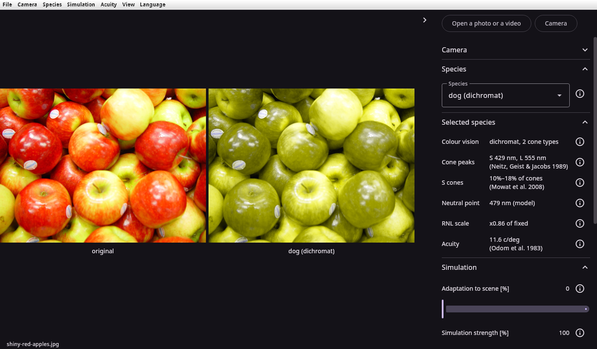
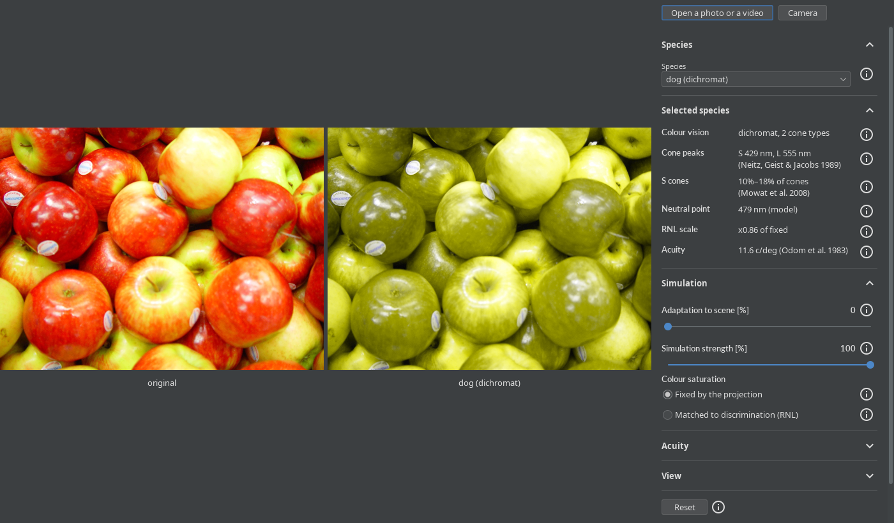

# Using dog-vision

What each program shows and how it is driven.\
[Building it](building.md) says how to build them.

- [The Android app](#the-android-app) — the controls, the camera and its mirroring, a photo or a video,
  saving at full size, recording and the language.
- [The web page](#the-web-page) — what a browser needs for the camera, snapshots and recording.
- [The command line](#the-command-line) — converting a photo or a video, `--species` and the other options, and [ffmpeg for a video](#a-video-needs-ffmpeg).
- [The desktop window](#the-desktop-window) — `dog-vision-compose` in Compose and `dog-vision-swing` in Swing,
  their GL on Linux and Windows, and ffmpeg for a video or the camera.

## The Android app

The app opens on the back camera, with the scene as it is and as a dog sees it.


- **The button with two arrows switches to the next camera** the phone lists, wrapping from the last to the first;
  it appears only when the phone has two or more cameras.
- **The front camera's image is mirrored**, like a face in a mirror, and saved and recorded that way;
  [The camera and its mirroring](#the-camera-and-its-mirroring) says how to change it.
- **The images are laid out as large as possible**: side by side on a wide screen,
  one above the other on a tall one, each with a caption under it saying what it shows.
- **The controls are beside the images on a wide screen and under them on a tall one.**\
  The button with three sliders over the images hides or shows the controls.
- **Each control and each fact has an info button** that explains it in a few paragraphs.

### The controls

The controls are grouped in sections, and tapping a section's title opens or closes it.\
The web page and the desktop window show the same ones.

| Control                       | Does                                                     |
|-------------------------------|----------------------------------------------------------|
| *Camera*                      | which camera is shown, or *Off*, which shows nothing     |
| *Mirroring*                   | whether the camera's image is mirrored                   |
| *Species*                     | picks the animal                                         |
| *Selected species*            | its cones, their sources, its RNL factors and its acuity |
| *Adaptation to scene [%]*     | adapts the cones to the scene instead of to daylight     |
| *Simulation strength [%]*     | blends the simulation with the original                  |
| *Colour saturation*           | how saturated the colours come out                       |
| *Blur to the species' acuity* | removes the detail finer than the species resolves       |
| *Image spans [degrees]*       | how wide the image is in degrees, which sets the blur    |
| *Side by side*                | a second image beside the simulation, or not             |
| *Compared with*               | the original, or another species, in that second image   |
| *Map of differences*          | a third image marking where the first two differ         |
| *Reset*                       | every control back to where it started                   |
| *Language*                    | the app's language; *As the system* follows the phone    |

[The model](model.md) explains what each control does to the picture, and which measurements each effect rests on.

- **The ⋮ button next to the others opens a menu with everything**: *File* has what the buttons do,
  and *Camera*, *Species*, *Simulation*, *Acuity*, *View* and *Language* have the sections of the controls,
  with each slider offered as fixed values: 0, 25, 50, 75 and 100 %, or 10°, 30°, 60°, 90° and 120°.
- **Choosing a menu shows its entries in place of the list**, under a row that goes back up,
  and a list inside it, such as *Compared with* or *Adaptation to scene [%]*, opens the same way.\
  Choosing an entry closes the menu.

When Android ends the app in the background to free memory, the controls stay as they were,
and so do the camera shown or *Off*, and the photo or video shown instead (a video from its start).\
A photo or video that can no longer be read by then, for example because it was deleted in the meantime,
gives way to the camera, and a message says so.

### The camera and its mirroring

The *Camera* section of the controls is the same in the app, the web page and both desktop windows;
in the app and the windows it starts closed.

- ***Camera* lists *Off* and every camera**:
  in the app by where they face, *Back camera*, *Front camera*, and *Camera N* for an external one;
  on the web page and in the desktop windows by the names the browser or the system gives them.
- ***Off* stops the camera and shows nothing**, until a camera, a photo or a video is chosen.\
  While a photo or a video is shown, the camera is already off: the list shows *Off*, and choosing it changes nothing.
- **One *Mirroring* choice covers every camera**: *Mirror*, *Do not mirror*, or *Automatic*, the default.
- ***Automatic* mirrors a camera that faces the viewer, and not one that faces away**,
  and says in brackets which it is: *Automatic (front)* or *Automatic (back)*.
- **When a camera does not report which way it faces, *Automatic* cannot be chosen**,
  and if it was chosen already, it is shown as *Mirror* and acts as *Mirror*,
  since such a camera is most likely a webcam facing the viewer.\
  Switching to a camera that does report its direction brings *Automatic* back.
- **The camera cannot be changed while the view is being recorded**, as the video's size would change;
  its mirroring can.

### A photo or a video instead of the camera

- **The picture button opens a photo or a video** through the system's photo picker, which needs no storage permission.
- **A photo is shown scaled down** to 1280 pixels on its longest side, so that the controls stay quick,
  and rotated as its EXIF orientation says.
- **A video plays at its own rate, over and over, without its sound**,
  scaled down like a photo and rotated as its rotation metadata says.
- **An HDR video is tone-mapped to SDR, as it is when converted**, so that it looks as it will once saved,
  if the GPU can do it (it needs `GL_EXT_YUV_target`);
  otherwise, as on the emulator, its HDR frames are taken as SDR and it looks flat.
- **The camera button goes back to the camera.**
- **You can open a photo or a video without granting the camera permission**;
  the app asks for it only to show the camera.

### Saving

Images go to *Pictures/Dog Vision* and videos to *Movies/Dog Vision*, where the gallery shows them:

- **The arrow button saves a snapshot** of the view as shown, at the size the images are rendered at:
  the camera's resolution, or the scaled-down view of a photo or a video.\
  It is called `dog-<species>-<time>.png`, or `dog-<left>-vs-<species>-<time>.png` when another species is compared.
- **The corners button saves the photo or the video at full size**,
  with the view as it is shown now, under the same kind of name ending in `-full.png` or `-full.mp4`,
  because the system photo picker does not tell an app the file's name.\
  A message shows the progress, and while it runs, the button becomes a cross that cancels it.
- **The conversion carries on in the background**, even if you leave the app or swipe it away from the recent apps:
  a notification shows the progress, with a button to cancel it, and then where the file was saved.\
  The first conversion asks whether the app may post notifications; without them, it runs anyway.
- **A photo is converted on the CPU.**
- **A video is converted by Media3's Transformer on the GPU**, with the original's sound:
  - it is encoded as H.265 if the phone has an encoder for it, and as H.264 otherwise;
  - it is scaled down, keeping its aspect ratio,
    if the encoder or the GPU cannot handle the view's size, and the message says so;
  - an HDR video is tone-mapped to SDR first, since the model works on SDR;
    a GPU without `GL_EXT_YUV_target`, such as the emulator's, cannot do that, and the conversion then fails,
    offering a button that converts the video as SDR, with flat colours.

Before Android 10, saving asks for the storage permission.

### Recording the view

- **The ring button records the view as shown**, every change included, until the square button stops it.
- **The video has 30 frames a second, without sound**, each frame repeated for as long as it was shown.
- **It is called `dog-<species>-<time>.mp4`** and goes to *Movies/Dog Vision*.
- **While it records, anything that would change the video's size is locked**:
  the source and the camera, *Side by side*, *Map of differences*, and the screen's orientation.
- **It stops when the app leaves the screen**, and the video recorded so far is saved.

### Language

- **The app speaks English and Czech.**
- **It starts in the phone's language**, and in English when the phone's is neither.
- **The *Language* choice at the end of the controls overrides it**,
  and so does the per-app language setting of Android 13 and later; Android remembers the choice.

## The web page


- **The built `index.html` works as it is**, opened from the folder or from any static server:
  the page fetches nothing, and its strings are compiled into `dog-vision.js`.
- **On Linux it is installed by the deb or rpm `dog-vision-web`**, or with all the other programs by `dog-vision`,
  as *Dog Vision (web)* in the desktop's menu, which opens the installed `index.html` in the system's browser.
- **On Windows the MSI installs it**, as its part *GUI (web browser)*,
  with *Dog Vision (web)* in the Start menu, which opens the installed `index.html` in the system's browser.\
  [Building it](building.md#what-each-package-holds) says what each package installs.
- **The script's source map is installed separately**, so that a browser's developer tools can show the Kotlin sources:
  the deb or rpm `dog-vision-web-sourcemap`, or the MSI's part *Source map*, which is not selected by default.
- **The browser needs WebGL 2**; without it, the page says so.
- **The page is in English or Czech**, as chosen at the end of its panel, which the browser remembers,
  or else in the browser's language if the page is translated into it.
- **The ⋮ button after the other buttons opens a menu with everything**: *File* has what the buttons do,
  and *Camera*, *Species*, *Simulation*, *Acuity*, *View* and *Language* have the panel's sections,
  with each slider as fixed values; *Camera* is there only if the browser offers a camera.
- **Choosing a menu replaces the list with its entries**, under a row that goes back up, as in the app;
  choosing an entry, clicking elsewhere or pressing Escape closes it.

### A photo or a video

- **Open a photo or a video opens either one**, and so does dropping one on the images.
- **A photo is scaled down to 1280 pixels** on its longest side, as in the app.
- **A video plays over and over without its sound**,
  scaled down like a photo, rotated as its file says, and paused while the page is hidden.
- **Playback depends on the browser**: its codecs, and its own tone mapping of an HDR video.

### The camera

- **Clicking Camera starts the camera**; the browser first asks whether the page may use it.
- **It shows the back camera first**, if the device tells its cameras apart.\
  It asks for 1280 x 720, the size of the app's frames;
  a camera without 1280 x 720 gives the nearest size it has, such as 640 x 480.
- **Switch camera goes to the next camera the browser lists**;
  it appears only when the browser knows of two or more cameras.
- **The cameras are listed once the page is allowed to use a camera**:
  right away if it was allowed before, otherwise after the camera first starts;
  until then the browser names none, and the panel's *Camera* lists only *Off*.\
  A camera plugged in or out is added to the list or dropped from it as it happens; the last one unplugged stays listed.
- **A camera reports which way it faces through its `facingMode`**,
  which a phone's cameras set and a laptop's webcam often does not;
  [*Automatic*](#the-camera-and-its-mirroring) follows it.
- **The camera stops while the page is hidden**, and starts again when it is shown; opening a photo or a video stops it.

#### Caveat: the camera needs a secure context

The browser offers a camera only to a page served over `https:` or from `localhost`,
or to a page opened as a file, which Chrome 154 and Firefox 156 treat as secure too.\
Served over plain `http:` from anywhere else, the page shows no Camera button.

### Saving and recording

- **Save snapshot downloads the view as shown**, as a PNG named like the app's snapshots,
  at the size the photo, or the video's or the camera's frame, is shown at;
  unlike the app, the web page cannot save a photo or a video at full size.
- **The snapshot needs `CompressionStream`**, which Chrome 80, Firefox 113 and Safari 16.4 were the first to support.
- **Record video records the view as shown** until Stop recording, as the app does:
  the images at the size they are composed at,
  in the arrangement they had when recording started, without captions or sound, at up to 30 frames a second.
- **The browser saves it as `dog-<species>-<time>.mp4`**, or as `.webm` if it cannot record MP4:
  Chrome 154 records H.264 in MP4, Firefox 156 VP8 in WebM.\
  A WebM recorded by a browser does not state its duration, so a player may be unable to seek in it.
- **While it records, anything that would change the video's size is locked**:
  the source, the camera, *Side by side* and *Map of differences*.
- **It stops when the page is hidden**, and the video recorded so far is saved.

#### Caveat: Firefox on Android records no video of a file

In Firefox 156 on Android, a video's frames come out magenta in the recording.\
Recording the camera or a photo works there.

## The command line

```sh
dog-vision-cli --species cat --compare dog photo.jpg            # from the deb or the rpm
dog-vision-cli --species cat --compare dog photo.jpg            # from the MSI, on Windows
dog-vision-cli\dog-vision-cli.exe --species cat photo.jpg       # from the zip, on Windows
java -jar dog-vision-cli.jar --species cat --compare dog photo.jpg
dog-vision-cli --species cat clip.mp4                           # a video, through ffmpeg
```

- **On Linux it is a package of its own, `dog-vision-cli`**, installed from its deb or rpm,
  or with all the other programs from `dog-vision`.\
  It runs as `dog-vision-cli` from the `PATH` on the system's Java 17 or newer,
  which the package manager installs along with it if there is none.\
  A headless Java is enough, as it opens no window.\
  Its JARs come in the package `dog-vision-common`, which the windows' packages run on too.
- **On Windows the MSI installs it alongside both windows**, as its part *Command line*, and puts it on the `PATH`,
  so that it runs as `dog-vision-cli` in any console opened afterwards, on the Java the MSI brings.\
  [Building it](building.md#what-each-package-holds) says what the MSI installs.
- **Or as a zip**, which you unpack and run as `dog-vision-cli\dog-vision-cli.exe`; it puts nothing on the `PATH`.\
  [Building it](building.md#the-command-lines-zip-for-windows) says how it is made.
- **Anywhere else, the JAR runs on a Java 17 or newer**: `./gradlew :cli:uberJar` builds it, with everything it needs.
- **It converts a photo at full size**: it writes a PNG next to the photo, or into `--output-dir`,
  and reports the share of pixels that differ when `--difference` asks for the map.
- **It converts a video at full size, frame by frame**: each frame like a photo,
  with the scene's mean taken afresh for each frame, into an .mp4 with the original's sound;
  on a terminal it shows its progress.
- **The PNG or the .mp4 is named after the file and the species it shows**:
  `photo.dog.png`, `photo.cat.png` with `--species cat`,
  `photo.horse-vs-cat.png` with `--compare horse` too, and `clip.dog.mp4` for a video.
- **It takes options for the view**:
  `--species`, `--compare`, `--difference`, `--adaptation`, `--strength`, `--chroma-scale`, `--acuity` and `--fov`;
  `--help` lists them, and so does running it with no file.\
  It has no window; the desktop window is a separate program.
- **`--info` prints the model derived for `--species`**:
  the cone and simulation matrices, the checks they pass, and the species' facts.
- **A photo is rotated as its EXIF orientation says.**
- **It uses the system's language, English or Czech, chosen the way gettext chooses it**:
  the list in `LANGUAGE`, such as `cs:en`, if it is set, or else `LC_ALL`, `LC_MESSAGES` or `LANG`,
  and on Windows the system's own language.\
  The windows do the same.

### A video needs ffmpeg

- **ffmpeg and ffprobe read and write the video**, found on the `PATH`, or on Windows where a window downloaded them.\
  The deb and the rpm recommend ffmpeg, which apt, dnf and zypper install with them unless told not to.\
  Without them a video cannot be converted, as the JVM has no decoder to fall back on.
- **The .mp4 is written by the best encoder ffmpeg has on this machine**:
  H.265 (`libx265`, or a GPU's), else H.264, else MPEG-4, each tried on three frames first;
  `libx265` is used only for a video at least 50 pixels wide.
- **It is tagged BT.709**, the matrix its frames are encoded with, so that a player shows the colours as they were.
- **The sound is copied as it is** if an .mp4 can hold its codec, and re-encoded to AAC otherwise.
- **A video with a variable frame rate is read at its average rate**,
  with frames repeated or dropped so that the sound stays in sync.
- **An HDR video is not tone-mapped**; the app tone-maps one.

## The desktop window

```sh
dog-vision-compose                          # the camera, /dev/video0 on Linux
dog-vision-compose photo.jpg                # a photo, or a video played over and over
dog-vision-compose --species cat --camera 1 # the cat's view of the second camera
```

It runs on Linux and Windows on x86-64.



- **On Linux it is installed by the deb or rpm `dog-vision-compose`**, or with all the other programs by `dog-vision`,
  as `dog-vision-compose` on the `PATH`
  and *Dog Vision (Kotlin Compose)* in the desktop's menu (*Jak vidí pes (Kotlin Compose)* in Czech).\
  It runs on the system's Java 17 or newer, which the package manager installs along with it if there is none.\
  It recommends `dog-vision-cli`, the command line on its own, which is a separate package.
- **The tar.gz runs without installing**: unpacked anywhere, it runs as `dog-vision-compose/bin/dog-vision-compose`,
  on its own bundled Java.\
  On Windows, the MSI installs it with its own Java as well.
- **Its launcher uses the first Java that is 17 or newer and not headless**,
  looking in `JAVA_HOME`, then on the `PATH`, then for the newest in `/usr/lib/jvm` or `/usr/lib64/jvm`.
- **It takes the command line's options** for the view it starts with and resets to,
  and options of its own: `--camera`, `--gl`, and `--output-dir` for where snapshots and recordings go.\
  Given a file, it shows it rather than converting it.
- **`--help` lists them**: on the terminal on Linux,
  and on Windows, where the window has no console, in a window of its own, whose text can be selected and copied.\
  A command line it cannot read is reported the same way.
- **A photo is scaled down to 1280 pixels** for the view, as in the app.
- **Open a photo or a video opens another one** in the system's dialog, which starts in the folder of the file shown;
  Ctrl+O opens the dialog too, and dropping a file anywhere on the window opens it.
- **On Linux the dialog is kdialog on KDE and zenity elsewhere**, whichever of the two is installed,
  and Java's own if neither is.\
  On KDE, Java's dialog opens behind the window from the second time on.
- **The Camera button goes back to the camera**, the one shown last or else the one the command line names,
  and turns it off if it is already shown, whereas *File* → *Camera* only shows it;
  the panel's [*Camera*](#the-camera-and-its-mirroring) picks another camera, or *Off*.
- **The cameras are listed afresh each time the panel's list drops down**, so that one plugged in since then appears;
  on Windows, where ffmpeg lists them, they appear a moment after the list opens.
- **The panel's last section, *The model and its checks*, shows what `--info` prints**
  for the species and settings shown, updated as they change; it starts closed, and its text can be selected.
- **F9 or the arrow at the edge of the images hides the controls**, and the images take up the space;
  doing it again shows them, and the next run starts with them as they were left.
- **Ctrl+M or *View* → *Menu bar* hides the menu bar**,
  and the window starts without it from then on, until Ctrl+M shows it again.
- **While the menu bar is hidden, three dots under that arrow open the menus**:
  in the Swing window each menu is a submenu of the list,
  and in the Compose window choosing a menu replaces the list with its entries,
  under a row that goes back up, as in the app.
- **Resting the pointer for a moment at the window's top edge, or just above it on the title bar,
  shows the menu bar over the images**, until the pointer leaves the bar or one of its menus closes.
- **Ctrl+Q closes the window**, except while a list is dropped down, which then takes the key.
- **Escape closes a dropped-down list or an open menu, not the window.**
- **The menu bar has everything the panel has**: *File* has the window's commands,
  among them opening a photo or a video, the camera and quitting,
  and *Camera*, *Species*, *Simulation*, *Acuity*, *View* and *Language* have the panel's controls.
- **In the menus a slider is a choice of fixed values**: 0, 25, 50, 75 and 100 % for the adaptation and the strength,
  and 10°, 30°, 60°, 90° and 120° for the angle the image spans; the panel's slider still sets any value.
- **Ctrl+B turns side by side on or off, Ctrl+D the map of differences, and Ctrl+0 resets**,
  as Ctrl+0 resets a zoom;
  the menus show each key beside its entry, and a key does nothing while its entry is disabled.
- **The keys follow the desktop's conventions**: Ctrl+O to open, Ctrl+Q to quit,
  F9 for the controls at the side and Ctrl+M for the menu bar,
  as KDE's programs use them for their side panel and their menu bar.
- **Ctrl+S or *File* → *Save snapshot* saves the view as a PNG**: its images,
  side by side or one above the other as the window shows them, without the captions, at the size they are composed at:
  the photo's, the video's or the camera's, scaled down to 1280 pixels on its longest side.\
  It is named after the species and the time,
  such as `dog-cat-20261008-090507.png`, or `dog-horse-vs-cat-20261008-090507.png` when a horse is shown beside a cat.
- **Snapshots and recordings go to the output folder**: the one `--output-dir` names,
  or else the one last chosen with *File* → *Output folder…*, which is kept for the next run,
  or else the user's pictures folder.\
  A folder chosen in the window replaces the one `--output-dir` names for the rest of the run;
  the next run started with `--output-dir` uses that one again.
- **The user's pictures folder is the one the system names**:
  on Windows the Pictures folder that Windows knows, even if it was moved;
  on Linux the one `XDG_PICTURES_DIR` names in `user-dirs.dirs`, as the file managers show it, such as `~/Obrázky`,
  or the home folder if it names none.
- **On Windows the output folder is picked in Java's dialog**,
  as on Linux when neither kdialog nor zenity is installed;
  the dialog is in the window's language, even though Java itself has no Czech translation.\
  Where the Compose window uses GTK's look, as on GNOME, part of the dialog stays in English,
  because GTK's look brings labels of its own.
- **Ctrl+E or *File* → *Convert file* converts the file shown at full size**, with the view the window shows,
  as `dog-vision-cli` converts a file: next to it, as `photo.dog.png` or `clip.cat.mp4`,
  or into the output folder if *File* → *Converted files into the output folder* is checked.\
  *File* → *Cancel the conversion* stops it and removes the unfinished file, and so does closing the window.\
  A video needs ffmpeg.
- **`settings.json` keeps the chosen folder, whether converted files go into it,
  and whether the menu bar and the controls are shown**:
  on Linux in `$XDG_CONFIG_HOME/dog-vision`, or `~/.config/dog-vision` if that is not set,
  and on Windows in `%APPDATA%\dog-vision`.
- **The status bar under the images says what is shown**, the file's or the camera's name,
  the progress of a conversion, and what the window did last: where a snapshot went, or why it could not be saved.
- **Ctrl+R or *File* → *Record video* records the view** into an .mp4 in the output folder,
  named like a snapshot, until the same key or entry stops it or the window closes:
  its images as a snapshot has them, 30 frames a second, each shown for as long as the window showed it, and no sound.\
  It needs ffmpeg, as a video does:
  if ffmpeg cannot run, nothing is recorded, and the window says so in place of the images, as it does for a video.
- **While it records, anything that would change the video's size is locked**:
  another file, the camera, side by side and the map of differences.
- **The status bar shows how long the recording has run**, then where it went and which encoder wrote it,
  or why it failed.

### The same window in Swing: `dog-vision-swing`

```sh
dog-vision-swing photo.jpg   # as dog-vision-compose, with the same options, keys and dialog
```



- **It shows what the Compose window shows, from the same state**, the `LiveSession` in [`gui-core`](../gui-core):
  the same images, drawn by the same passes, and the same controls, in Swing's own widgets with [FlatLaf](https://www.formdev.com/flatlaf/).
- **It needs neither Compose nor skiko**, so its packages leave out Compose's JARs and skiko's natives.
- **On Linux it is installed by the deb or rpm `dog-vision-swing`**, or with all the other programs by `dog-vision`,
  as `dog-vision-swing` on the `PATH` and *Dog Vision (Java Swing)* in the desktop's menu
  (*Jak vidí pes (Java Swing)* in Czech), next to `dog-vision-compose` if both are installed.\
  Its tar.gz runs as `dog-vision-swing/bin/dog-vision-swing`, and on Windows the MSI installs it,
  as its part *GUI (Java Swing)*, alongside the Compose window's *GUI (Compose Multiplatform)*.
- **It is light or dark, following the desktop**:
  on Linux the desktop portal's colour scheme, which GNOME and KDE set,
  on Windows `AppsUseLightTheme`.\
  It is light if the setting cannot be read.
- **It draws the images at the screen's own pixels**,
  not at Swing's scaled ones, so that they are as sharp on a HiDPI screen as in the Compose window.

The sections below apply to both windows.

### The GPU it draws on

- **On Linux it needs EGL with Mesa's device platform** (`EGL_EXT_platform_device`) for an OpenGL ES 3 context,
  and uses the first device with a DRM render node;
  if there is none, it renders on the CPU and says so on its standard error.
- **On Windows it draws through ANGLE**, OpenGL ES 3 over Direct3D 11, as Chrome draws WebGL there; ANGLE comes with it.
- **If ANGLE cannot start, it draws through WGL**, the graphics driver's own desktop OpenGL 3.3.\
  `--gl angle` or `--gl wgl` forces one of them, with no fallback to the other.

### A video or the camera, through ffmpeg

- **A video or the camera comes through the system's `ffmpeg`**, which must be on the `PATH` together with `ffprobe`;
  if either cannot run, the window says so in place of the video or the camera.
- **A video plays at its own speed**, without its sound, rotated as its file says and scaled down like a photo;
  an HDR video is not tone-mapped.
- **`--camera N` is `/dev/videoN` on Linux**, through Video4Linux,
  and on Windows the Nth camera ffmpeg lists through DirectShow, counted from 0.
- **The window asks the camera for Motion-JPEG at 1280 x 720**, which a USB webcam delivers at 30 frames a second,
  and takes whatever the camera gives if it does not offer that.
- **The panel lists the cameras by the system's names**:
  on Linux each `/dev/videoN` by the name its driver gives it,
  except a webcam's second node, which gives metadata, not frames;
  on Windows the cameras ffmpeg lists through DirectShow.
- **Only on Linux can the window tell which way a camera faces**:
  from the side of the computer that the firmware places its USB device or port on,
  which sysfs gives as `physical_location`;
  where the firmware gives no side, or one other than the front or the back, the direction is unknown,
  as it is for every camera on Windows.\
  Neither Video4Linux nor DirectShow says which way a camera faces,
  so [*Automatic*](#the-camera-and-its-mirroring) is offered only where the firmware places the camera on the front or the back.

#### On Windows, the window offers to download ffmpeg

- **Windows has no ffmpeg of its own**, so the window offers to download it, with *Download ffmpeg*:
  BtbN's newest build of the release branch that `ffmpeg-windows`
  names in [`libs.versions.toml`](../gradle/libs.versions.toml),
  checked against the release's `checksums.sha256`.
- **It goes into `%ProgramData%\Dog Vision`**, where both windows find it, for every user of the machine;
  uninstalling the MSI removes the folder, and upgrading it does not.
- **If winget is on the `PATH`**, the window also offers to install it through winget,
  as Gyan's build (`winget install --id Gyan.FFmpeg`) for the current user only,
  which winget keeps up to date and the MSI leaves alone.
- **Once ffmpeg is found, the window shows the video, the camera, or the photo that Ctrl+R could not record**,
  without a restart; Ctrl+R then records.
- **If winget turns out to be missing after all**,
  the window shows a link to ffmpeg's download page, which opens in the browser when clicked.
